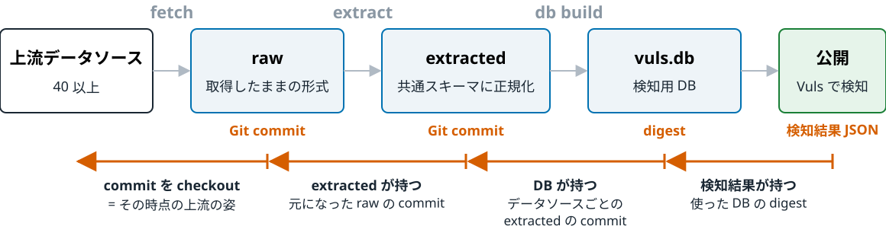

<!-- _class: lead -->
<!-- _paginate: false -->

# 脆弱性情報の上流は安定していない
## 公開前検査による116日間の全数観測

篠原 俊一・中岡 典弘・神戸 康多(フューチャー株式会社)

コンピュータセキュリティシンポジウム 2026 / OWS 2026 / 2F1-2

<!--
発表 15 分 + 質疑 5 分。本編 24 枚 + 予備 6 枚(2026-10-15)。リハで時間を測り、「削減候補」コメントの枚から削る。
-->

---

<!-- _class: takeaway -->

# まとめ

1) 脆弱性情報の上流は **2 日に 1 件**のペースで大きく動く。<br>消え、戻り、書き換わる。しかも**大半は正当な変更**。
2) でも自動ビルドでは、**本当にまずい DB**がたまにできる。<br>1 か月分の CVE がまるごと消える。**10 万ファイルが半日ごとに入れ替わる**。<br>公開前に**止めないといけない**。
3) 公開前に前回の DB との差を見て、**大きな差分はひとまず止める**ようにした。<br>116 日間、止めた全件の原因を履歴で特定し、**本当にまずい DB を 3 回捨てた**。<br>原因の特定はほぼ AI に任せ、公開の最終判断だけ人がする。

<!--
116 日・943 run の本番データ(2026-04-23〜08-16)と、その後の出来事からの結論。
-->

---

# 前提: 脆弱性 DB の全自動ビルドと公開


- raw と extracted は**ソースごとの Git 履歴**、DB は **digest** で、GHCR に置く
- **どの時点の上流の姿も、あとから取り出せる**。原因調べはこの履歴をさかのぼる

---

# さかのぼり方: どの生成物も、入力のハッシュを持っている



- 手元の検知結果 1 つから、**その時点の上流の姿まで**戻れる。しくみはこれだけ

<!--
実物(2026-10-14 の vuls-nightly-db:0)の alma-errata レコード:
raw ghcr.io/vulsio/vuls-data-db:vuls-data-raw-alma-errata @ ee83c674 (2026-10-13T18:35:56Z)、
extracted vuls-data-extracted-alma-errata @ 96fe5b2d (20:47:33Z)、created_by vuls v0.0.1-alpha.0.20261013060026-42367478a97a、
digest sha256:e267d756…。`vuls db search datasources` / `search metadata` で読める。
extracted 自身の commit は DB 構築時(db-main.mk の db-add)に datasource.json へ埋める。
検知結果 JSON(Vuls のスキャン結果)は config.report.vuls2.Digest に使った DB の digest を持つ(future-architect/vuls #2311、2025-09)。利用者の手元の結果 → digest で DB を特定 → datasources で raw commit まで戻れる。
-->

---

# きっかけ: 2026年3月、壊れた DB を2回公開した

- redhat:9 の検知が **51.9% 消えた** <span class="verdict">→ 見逃し (FN)</span>
  - Red Hat VEX から壊れたデータが来た日に、こちらが形式を変えた
  - 変換が空振りし、**空のデータ**を生成
- ubuntu 22.04 の検知が**倍になった**(+106.0%) <span class="verdict">→ 過検知 (FP)</span>
  - Ubuntu CVE Tracker の DB に新しいフラグを入れた
  - **古いスキャナ**がそのフラグを読めない

<div class="wrap">

どちらも上流ではなく**自前のバグ**。それでも**ビルドは成功**し、そのまま公開された

<div class="point">同じようなバグを、公開前に止める方法が必要</div>

</div>

<!--
口頭: 利用者から問い合わせ → 運用チームがバックアップからリストア → 利用者にお詫び。迷惑をかけたのは利用者だけでなく運用チームにも。サービス名は出さない。
-->

---

# 作ったもの: 公開前検査 (diff guard)


* **検知(新)**: 最新のバイナリで検知実行、CVE の集合をくらべる(検知入力はスキャン結果 75 本)
* **検知(旧)**: 固定した旧バイナリで同じことを。旧版との非互換(3 月の 2 件目)を捕まえる
* **DB 構造**: DB の中の検知条件(約 330 万件)をソース別に直接くらべる
* 止めた DB はタグなしで残る。正当なら人が **promote**(公開に昇格)する

<!--
3 観点の呼び方: 検知(新)= 最新スキャナ、検知(旧)= 固定した旧スキャナ、DB 構造 = DB を直接比較。論文の Dn / Do / DB。
質疑: 検知(旧)だけで止まった件は 116 日で 0 件。それでも置くのは、DB とスキャナの更新周期が一致しない中で、継続利用される旧版との互換性を公開境界で確かめる回帰テストだから(3 月の 2 件目の型)。
-->

---

# 実物: 止まったとき、人が見るもの

<div class="small">

GitHub Actions のジョブ要約、2026-06-16(あとで出てくる Microsoft の件。表はいまの形式)。
3 つの観点のまとめ:

| 観点 | 結果 |
|---|---|
| 検知(新) | **FAIL** |
| 検知(旧) | PASS |
| DB 構造 | PASS |

検知(新)の内訳(13 件が FAIL、一部):

| scan result | baseline | target | added | removed | change rate | threshold | result |
|---|--:|--:|--:|--:|--:|--:|---|
| windows_11_21h2 | 879 | 472 | 0 | 407 | **46.3%** | 10.0% | **FAIL** |
| windows_11_25h2 | 1235 | 722 | 0 | 513 | **41.5%** | 20.0% | **FAIL** |
| windows_server_2025 | 1802 | 1285 | 0 | 517 | **28.7%** | 20.0% | **FAIL** |
| windows_10_22h2 | 2697 | 2198 | 0 | 499 | **18.5%** | 10.0% | **FAIL** |

</div>

- **大幅な減少**。実際には 6 月分の CVE が検知から消えていた

<!--
まとめ表は 2026-08-24 以降の形式。この run 当時は 1 行のテキスト(diff guard failed: detection(master)=1 ...)。
TODO: 本物のスクショに差し替え候補(run 27646259547 の Summary タブ)。
質疑: 検知(旧)が PASS なのは、旧版用の検知入力に windows が入っていないため(カタログ A-4)。DB 構造も PASS だったのは KB の集合しか見ていなかったから。
-->

---

# 見込み: 「2週間に1回止まる程度かな」(甘かった)


- 入れる前に、となり合う日の DB 35 組で DB 構造の変動率を測った
- ふだんは中央値 **0.3%**。10% 超は **2 組**だけで、どちらも本物の上流の出来事
- 桁で分かれる境目から閾値を決めた: **DB 構造 10%**、検知は保守的に **5%**
- **2 週に 1 回くらいだろう**と思い、2026-04-23 に本番へ

---

# 現実: 翌日から止まった

- 翌日(2026-04-24)に止まり、最初の promote(04-27)まで **20 run 連続 FAIL**
- 続く 3 週間で promote **10 回**。ほぼ毎朝、まず結果を読んで promote
- 116 日間で 943 run 中 **420 run(44.5%)が FAIL**。promote は **1 日 0.79 回**
- FAIL した run の **半分(50%)が土日**。promote はほぼ平日の日中なので、金曜夕方の出来事が週末じゅう止まり続ける
- 止めているあいだは前回版が公開されたまま = **新しい CVE が遅れる**

<div class="wrap">
<div class="point">止まる回数は上流ではなく、人の応答の速さを映している</div>
</div>

<!--
土日の内訳: Sat 96 / Sun 113 の 209 run(418 run 中 50.0%、data/stats-output.txt)。削減候補: 「50% が土日」の 1 文だけ口頭で。
口頭(削った話): 止まっているあいだ前回版は動かないので同じ差分が 6 時間ごとに鳴り続ける。当初は 1 つ FAIL したら終わる作りで、debian_13 が ubuntu:26.04 の FAIL を隠していた(05-08 修正)。
-->

---

# 見方を変える: うるさい検査ではなく、上流の地震計

- 「止まりすぎ」を調べるうちに、FAIL の記録は**上流で何が起きたかの記録**だと気づいた
- 2026-04-23 〜 08-16 の **116 日・943 run を全部集めた**
- 同じソースの続きの FAIL をひとまとめにすると **69 件**
- 69 件すべてに「なぜ動いたか」を付ける

<!--
質疑: 69 件は「同じソースで 24 時間以上途切れたら別の件」という集約規則による。12 時間なら 77 件、48 時間なら 62 件(論文 4.1 節)。
質疑: 観測期間中に検査自体も改良している(5 月に 3 観点の全実行化、7 月にソース単位化と CPE 検知入力の追加)。結果は固定した測定器の同質な標本ではなく、運用中に改善された検査の発動履歴(論文 4.3 節の限界)。
-->

---

# 116日間のタイムライン


<div class="caption">69 件を上流ソースごとに並べたもの。横棒は最初の FAIL から解消まで</div>

<!--
削減候補: 前スライドに吸収。
-->

---

# 原因のしぼり込み: 履歴で工程を消していく

1. **DB 構築**: DB を作ったコード(vuls2)の版をくらべる
2. **収集・変換**: そのソースのコードの履歴を見る
3. **収集の設定**: 取る対象の変更を見る
4. **上流**: raw の Git 履歴から、件数と ID が合う変更を探す

* 69 件すべてに原因が付いた。**「原因不明」はゼロ**
* 全工程の履歴が残っているからできた。去年の基盤がここで効いた

<!--
手順 1 の補足: DB はデータのハッシュだけでなく、それを作った vuls2 の版(created_by)も持つ。
手順 2 の補足: 取得・変換のコードの版は raw / extracted に記録されていない。2 つの extracted commit の日付範囲で、そのソースの pkg/{fetch,extract}/ に触ったコミットを探す。次の実物の 2 行目がそれ。
削減候補: 次の「実物」と統合。
-->

---

# 結果: 69件のうち59件は上流が原因

| 原因 | 件数 | 例 |
|---|--:|---|
| 上流: 正当な変更 | **55** | 月例パッチ、新しい OS の立ち上がり |
| 上流: 一時的な障害 | 2 | ひと月分の月例データが消えた(Microsoft)|
| 上流: ずっと続く品質の変化 | 2 | errata の作り直し |
| 自分: 意図した変更 | 9 | CPE まわりの変換、取る対象の追加 |
| 自分: 変換コードのバグ | 1 | 出力順が不定 |

* 上流が原因の 59 件 = **2 日に 1 件**、上流は閾値を超えて動く
* ほとんどが**正当な変更**。「異常だから止まる」のではない

<!--
自分: 意図した変更 9 = 変換コードの意図した変更 7 + 収集対象設定の変更 2(論文の表 2 では別行)。
質疑: 正当な変更 55 件で止まるのは誤報ではないか → 月例や新 OS 立ち上がりのような反復する正当な大変動は対象別 override で吸収し、単発の大変動(例: Oracle UEK の 1 advisory に CVE 822 件)は人が見る対象として残す設計。
-->

---

<!-- _class: loose -->

# 絞り込み実例: promote するパターン

```
判定: upstream-driven(上流の正当な変更。promote 可)

FAIL: 検知(新)(旧)で amazon_2023 2080 → 2233(Added 153、7.4%、閾値 5%)

1. builder   : created_by 同一(vuls v0.0.1-alpha.0.20260622074355-fab747f7e5ef)→ 除外
2. extractor : 窓内に pkg/{extract,fetch}/amazon のコミットなし → 除外
3. settings  : vuls-data-db の窓内コミットは他ソースの追加のみ、amazon の設定に変更なし → 除外
4. raw       : vuls-data-raw-amazon cd2dc392(2026-06-23 02:04、185 files / +25,037 行)
   smoking gun: ALAS2023-2026-1882(kernel、Important、Issued 2026-06-22)が新規
                その CVE(CVE-2026-23255, CVE-2026-23272, CVE-2026-23399 …)が Added の ID と一致

推奨: 約 10 日ぶりの advisory 公開でバッチが大きくなっただけ。候補 sha256:d2155fc0… は promote 可(判断・実行は人間)
      単発なので閾値の override は不要
```

- Claude の SKILL にしてあり、調べる作業の大半は AI エージェントに任せる
- **promote の実行判断は人間**。エージェントに workflow を動かす権限は渡さない

<!--
当時の triage 原文は無く、data/diff-guard-incidents.md A-7(2026-06-23、DB run 28014227227)の数値から報告形式に再構成したもの。識別子は実データ。settings の行は vuls-data-db の 06-13〜23 のコミット一覧(jvn-feed-detail / mitre / vulncheck の追加、rename、rocky_10 の閾値)で確認(2026-10-15)。promote は d2155fc0 → :0(06-23 12:26)。同じ run で amazon_2_extra_kernel も 1299 → 1367(Added 68、5.2%)、ALAS2KERNEL-5.15-2026-107(CVE-2026-43079 ほか)。
Cisco(A-21、productNames 149 → 36 でも promote)の方は「整理に見えるが検知が消える」の例として予備スライドにある。
-->
---

<!-- _class: loose -->

# 絞り込み実例: promote しないパターン

```
判定: upstream-driven(上流の一時的なデータ障害。promote しない)

FAIL: 検知(新)で windows 13 ターゲットが削除のみの大変動
      windows_11_21h2 879 → 472(Removed 407、46.3%)、windows_11_25h2 1235 → 722 ほか

1. builder   : created_by 同一 → 除外
2. fetcher   : pkg/fetch/microsoft/cvrf は期間中コミットなし。fail-hard 設計でスキップ機構も無い → 除外
3. raw       : vuls-data-raw-microsoft-cvrf 4b5baa9 → 44181ca で 2026-Jun/ が丸ごと消失(723 → 0 ファイル)
   smoking gun: 2026-Jun/CVE-2026-48574.json(Windows Media RCE、published 06-09)がファイルごと消失
                extracted 5e47f25 → b21d21d で CVE ファイル 777 本削除(うち 754 が CVE-2026)
                MSRC API は HTTP 200 のまま 6 月の文書を返さなくなったと判断

推奨: 候補 ff6889e1 / b8c1fee3 は promote しない。6 月の Windows 脆弱性を欠いた欠陥品
      上流の回復を待って再実行する。閾値も触らない
```

- 取得も変換も正常。上流の返答が変わっただけ。候補は捨て、**13 時間後の fetch で戻った**

<!--
6 月当時の triage 原文は残っていないため、data/diff-guard-incidents.md A-4 の数値から同じ報告形式に再構成したもの。識別子は実データ。
口頭: このとき DB 構造の観点は PASS だった(KB の集合しか見ていない盲点)。07-02〜03 に同じことがもう一度起きた(この後の Microsoft の枚)。
-->

---


# 上流の壊れ方: 消える — Microsoft CVRF

<div class="cols cols-2-1">
<div>

- 6 月分の月例データ(723 ファイル)が raw から**丸ごと消え、戻り、また消えた**
- API は HTTP 200。取得も変換も**成功**
- できた DB から 6 月分の Windows CVE が消えた(2 回目は**約 1,270 件**)
- 検知(新)が windows 13 件の**減るだけ**の動きを捕まえた

</div>
<div class="mid">

raw の `git log`

| 日時 (UTC) | 変更行数 | 2026-06 の<br>ファイル数 |
|---|--:|--:|
| 06-15 16:57 | | 723 |
| 06-16 03:02 | −251,429 | **0** |
| 06-16 16:33 | +248,779 | 811 |
| 07-01 14:17 | | 1273 |
| 07-02 02:01 | −327,295 | **0** |
| 07-02 13:26 | +335,383 | 1273 |
| 07-03 01:42 | −327,838 | **0** |
| 07-03 13:33 | +338,693 | 1278 |

</div>
</div>

<!--
質疑: なぜ取得時に止めないのか → 月データの全消失のような既知の条件は取得時にも止められる(件数や既知 ID の消失の確認)が、全ソース共通の完全性条件は作れないので、公開境界の差分検査と併用する(論文 5.2 節)。
raw は vuls-data-raw-microsoft-cvrf(6 月分の実際のディレクトリ名は 2026-Jun/)。7 枚目のレポートがこの件。commit: 4b5baa90ccf(06-15)/ 44181ca9cd1(06-16 03:02、1460 files)/ 34a4bd55a5f / 5a0dbb67385 / 55abc741d7d(07-02 02:01、1273 files)/ 6dba0210f16 / 07846b78042 / 0b4ba6131cc。
-->

---

<!-- _class: loose -->

# 上流は骨抜きになる — AlmaLinux errata

- 2026-05-27、AlmaLinux 10 の errata が一斉に減った
  - advisory 自体が **279 → 一時 60 件**(残ったのは 136 件)
  - 残った advisory も骨抜き。例: ALSA-2026:2721(kernel)の対象パッケージが **75 種 → 2 種**
  - **CVE 376 件**が errata 全体から消えた
- `updated_date` は 2 月のまま。**更新とは扱われていない**
- 上流に聞くと「**仕様どおり**」。errata に載るのは**最新リリースのパッケージだけ**。<br>10.2 が出て(05-26)、10.1 向けの分が消えていた
- 対応: 落とされた advisory を**自分の raw 履歴(縮退前の commit)から復元**して取り込む

```
$ git show --stat e64c5ca88 -- 10/ALSA/2026/ALSA-2026:2721.json        # 2026-05-27
 10/ALSA/2026/ALSA-2026:2721.json | 2412 +-----------------------------------------
 1 file changed, 6 insertions(+), 2406 deletions(-)          "updated_date": 1771853624 (不変)
```

<!--
残った 136 advisory のうち 79 件(58%)で対象パッケージ数が半分以下。消えた 143 advisory が参照していた 434 CVE のうち 376 件(87%)は errata 全体から消失。AlmaLinux 10.2 は 2026-05-26 リリース(phoronix / wiki.almalinux.org)。2025-11-26 にも 102 件のパージがあり、マイナーが上がるたびに起きる。復元は vuls-data-db #191(2026-07-07、fetch-alma-errata.yml)。縮退前の snapshot commit と対象 advisory の一覧を workflow に明記し、fetch のたびにその分だけ戻す(1 回目 143 件、2 回目 102 件)。それまでは取り込みを縮退前の commit に固定していた。質疑: OVAL に切り替えないのか → alma-oval の取得は復活させた(vuls-data-update #882)が DB では未使用。updateinfo への切り替えを検討中で、DB はいまも errata。
raw vuls-data-raw-alma-errata。05-20 の 47a66696b = 202 packages / 75 種、05-27 の e64c5ca88 = 2(−2406/+6 行)。消えたのは kernel, kernel-core, kernel-rt-64k-debug など 73 種、残ったのは kernel-doc と kernel-abi-stablelists。updated_date 1771853654 → 1771853624(どちらも 2026-02-23)。
-->

---

<!-- _class: loose -->

# 骨抜き、その2: `x86_64_v2` が消えた(2026-10-12)<span class="badge">論文後</span>

- advisory **366 件**から `x86_64_v2` が消えた。`x86_64` は無傷
- rpm 本体は**いまもある**。消えたのは errata の記述だけ。`updated_date` も変わらず
- **DB 構造の観点が捕まえた**
- 翌日(10-13)の errata で**元に戻った**。その 1 日、`x86_64_v2` では**検知が消えていた**

```
ALSA-2026:19009(postgresql18)の packages を arch 別に数える
                 aarch64  ppc64le  s390x  x86_64  x86_64_v2   updated_date
  10-12 以前        13       13      13      13       13       1779798852
  10-12 20:40Z      13       13      13      13        0       1779798852   ← rpm は repo に残ったまま
  10-13 18:35Z      13       13      13      13       13       1779798852
10/ 全体の x86_64_v2 エントリ: 5660 → 3864 → 5759
```

<!--
発表 1 週間前の出来事。候補は 10-13 05:44 に :0 / :nightly へ promote した(検知の観点は PASS で、x86_64 の利用者には影響しないと判断)。検知の観点は PASS(スキャン結果の fixture が x86_64 のため)。366 件のうち 159 件は x86_64_v2 が全部消え、207 件は一部。raw の x86_64_v2 エントリは 5660(10-12 以前)→ 3864(10-12 20:40Z、0d591540ed)→ 5759(10-13 18:35Z、ee83c674cf)→ 5804(10-14)。上流の説明は未発見。DB 構造と検知の 2 観点の相補性の例でもある。
例: ALSA-2026:19009(postgresql18)x86_64_v2 13 → 0、x86_64 13 → 13。repo.almalinux.org の AppStream/x86_64_v2/os/Packages/ には postgresql18-server-18.3-1.el10_2.x86_64_v2.rpm がある。
guard: DB run 38324240469 alma:10 46.6% FAIL(単一閾値)、Nightly 38325837023 は added 1.0% / changed 22.8% / removed 0.0% で FAIL。検知(新)alma_10 774 → 776 PASS。
-->

---


<!-- _class: loose -->

# 上流は揺れる — VulnCheck

- **1 コミットで 145,672 ファイル**(+957 万行)。全年代の CVE に CPE 条件を一斉付与
  - CVE-1999-0001 にまで `matchCriteriaId: ""` の条件が付く
- **DB 構造の観点**が cpe で FAIL(added 587 / removed 64 / **changed 135,457**)。「増やしただけだろう」と見て **promote した**
  - cpe は 7 ソースをまとめて **28.9%**。VulnCheck だけなら **189.6%** だったが、NVD の大きさに薄まっていた
- 実際は CPE の書き方が変わって索引から外れ、CPE 経由の検知が**最大 75% 消えていた**(cpe_jvn 75%、cpe_cisco 64%)
- 「増えた」と「検知が減った」が同時に来る。**公開した DB には検知の後退が入っていた**

```
例: CVE-2012-5010(Cisco ASA)の CPE 条件。lastModified は 2026-06-16 のまま(表記は 2.3 形式に揃えた)
  07-08 より前   cpe:2.3:a:cisco:adaptive_security_appliance_software:-:*:*:*:*:*:*:*
  07-08 以降     cpe:2.3:o:cisco:adaptive_security_appliance_software:*:*:*:*:*:*:*:*
  検知入力       cpe:2.3:a:cisco:adaptive_security_appliance_software:9.8.1:*:*:*:*:*:*:*   → a: で引く索引に無い
```

<!--
翌日(2026-07-09)の DB 構造の観点: | cpe | detection 28.9% | KB 0.0% | threshold 10.0% | FAIL |、root ID added 587 / removed 64 / changed 135,457。
スキャン結果の fixture(vulsio/integration data/results/cpe_cisco.json)の実際の表記は cpe:/a:cisco:adaptive_security_appliance_software:9.8.1(2.2 形式)。スライドでは見やすさのため 2.3 形式に揃えた。a:cisco:adaptive_security_appliance_software を criteria に持つファイルは 82 → 46 に減った(raw 0bab5f54afd の前後、2026-10-14 調査)。
口頭: この promote は、CPE 検知がまだ開発中で本番の検知には影響しないと見て「開発版だからええやろ」と通したもの。
当時 cpe は 7 ソースをまとめて比較していて、VulnCheck 単体では 189.6% だったのが NVD の大きさに埋もれて 28.9% に薄まっていた。検知の減少は cpe_jvn 69 → 17、cpe_cisco 67 → 24、cpe_nvd 24 → 19(予備スライド「ソース単位で測り直すと」)。この件を機に閾値をソース単位にし、CPE のスキャン結果も検知の観点に足した(2026-07-14)。
-->
---


# 上流は揺れる(2): VulnCheck の10万ファイルが半日ごとに往復する

- 一斉付与のあと、**約 10 万ファイルが 12 時間ごとに 2 つの版を行き来**した。`lastModified` は動かない
- 07-21 に `a:cisco:…` の CPE が 82 ファイルに現れ、翌日消えた。検知が **22 → 67 → 22** と 7 時間で往復
- 2026-10-14 時点で cpe_cisco の検知は **10 件**。VulnCheck 経由の Cisco の検知はほぼ失われた

<div class="mid">

| 日時 (UTC) | 変更ファイル数 | 補足 |
|---|--:|---|
| 07-08 13:24 | 145,672 | 一斉付与 |
| 07-10 13:53 | 101,264 | 別の版に書き換え |
| 07-11 01:21 | 99,986 | **07-08 の版に戻る**(抽出 3,000 ファイルで 100% 一致) |
| 07-11 12:48 | 99,196 | **07-10 の版に戻る**(同上) |
| 07-21 13:12 | 5,925 | `a:cisco:…` が 82 ファイルに出現 |
| 07-22 01:19 | 3,579 | その `a:cisco:…` が消える |

</div>

<!--
「ムカつく」枚。raw vuls-data-raw-vulncheck-nist-nvd2。commit: 0bab5f54afd / b2d593f6c56 / ae7c83caf56 / 8e030dba52d / 1f21242a634 / c2c205a79ae。往復の一致率は、各コミットの変更ファイル 3,000 件を抽出して 2 つ前の blob と比較。
CVE-2013-5510(Cisco ASA)では CPE が 255 本 ↔ 171 本(part はどちらも o:)。
検知(新)cpe_cisco / vulncheck-nist-nvd2: 07-22 01:14 baseline 22 → target 67(added 45、204.5% FAIL)、07-22 08:01 67 → 22(removed 45、67.2% FAIL)。
削減候補: 時間が無ければ前の枚に「07-22 に 22→67→22」の 1 行だけ残す。
-->
---


# 現在地(1): 検査が止めた3件

- **Microsoft CVRF の 6 月分の消失 × 2**: Windows の 6 月分 CVE(最大約 1,270 件)の検知が消える DB を**公開せずに捨てた**
- **自分の変換コードのバグ × 1**(fedora): **検知には影響ないがバグっていた**。コンパイルもテストも通るバグが、出力の差分で初めて見えた

<!--
質疑: 止まらずに通った破損は無いのか → 利用者報告と事後分析の範囲では確認していない。ただし未検知の破損が無いことを網羅的に確かめる手段は無い(論文 5.3 節)。
fedora のバグ(A-6、2026-06-19): DB 構造の観点が fedora:45 で 274.5%。raw は 266 ファイルなのに extracted は 23,163 → 上流ではなく自分。FEDORA-2026-54c7ad647e の package "bind" の architectures が ["aarch64","i686",…] → ["src","x86_64","aarch64",…] と並び順だけ変わっていた(raw はバイト同一)。vuls-data-update pkg/extract/fedora/api/api.go で util.Write(path, &data) とポインタを渡していたため type switch の case Data: に落ちず Sort() されない。修正 PR #854。
-->
---

# 現在地(2): 検査が止めきれなかった2件

- **AlmaLinux の骨抜き**: たまった FAIL を片づける流れで promote → **数時間公開してしまった**
- **VulnCheck**: 薄まった 28.9% を見て promote → 検知が減った DB を公開した

<div class="wrap">
<div class="point">2 件とも見つけて止めるまではできた。失敗したのは人の判断</div>
</div>

* 対策: 見せ方を細かく → **ソースごと**に測る(2026-07-14)
* 対策: 増える方向より**減る方向を厳しく**見る

<!--
vuls2 diff の既定値(vuls2#449、2026-10-09 merge): diff db --rate-threshold added:30,changed:10,removed:10 / diff detection --rate-threshold added:30,removed:5。override は軸を名指ししないと緩まない(例: --rate-threshold-override cpe/cisco-json=removed:25)。
-->

---


<!-- _class: takeaway -->

# まとめ

1. 脆弱性情報の上流は **2 日に 1 件**のペースで大きく動く。<br>消え、戻り、書き換わる。しかも**大半は正当な変更**。
2. でも自動ビルドでは、**本当にまずい DB**がたまにできる。
3. 公開前に前回の DB との差を見て、**大きな差分はひとまず止める**ようにした。<br>116 日間、止めた全件の原因を履歴で特定し、**本当にまずい DB を 3 回捨てた**。

<div class="wrap reveal">

* <span class="point">針路</span><ul><li>増える方向と減る方向で閾値を分け、<strong>減る方向を厳しく</strong>(論文後に実装済み)</li><li><strong>ソース単位の据え置き</strong>: DB 全体を止めず、だめなソースだけ前回版に戻して公開(実装中)</li><li>検査が約束できるのは自動で止めるまで。<strong>承認する側の設計</strong>は長期の課題</li></ul>

</div>

<!--
前の枚までの根拠: CI が見るのは「ビルドが通ったか」で、「できたものが正しいか」ではない。前回とくらべて初めて分かる。
-->
---

<!-- _class: lead -->

# 公開しています

論文・データ(run 表、69 件の判定表、集計スクリプト)
**github.com/vulsio/css2026-diff-guard**

検査の実装: vuls2 / 閾値の設定: vulsio/vuls-data-db

ご質問・追試歓迎です

---

<!-- _class: loose -->
<!-- _paginate: skip -->

# 予備: 上流の一時的な欠落 → promote しない(2026-09-26)

```
判定: upstream-driven(JVN フィードの一時的な欠落。据え置き推奨)

FAIL: cpe_nvd / jvn-feed-rss  71 → 56(Removed 15、21.1%、閾値 5%)

1. builder   : created_by 同一 → 除外
2. extractor : extractor・fetcher は 09-20 以降コミットなし → 除外
3. settings  : vuls-data-db は 09-24〜27 コミットなし → 除外
4. raw       : vuls-data-raw-jvn-feed-rss d37d1eda43 → ac66be6273 は A:490 / M:1 / D:426(前日は D:0)
   smoking gun: 削除 426 件は全件 modified が 2026-09-25。JVNDB-2026-034354〜034784 の連番ブロック
                代表 2026/JVNDB-2026-034784.json(Apache Tomcat)が削除 → 参照する 15 CVE が検知から消えた
   原因: jvndb_new.rdf は直近 500 件の窓。9/25 は 1224 件公開され前半 426 件が押し出され、
         年次 jvndb_2026.rdf にまだ載っていない隙間に fetch が当たった

推奨: 閾値変更は不要。promote もしない。候補 DB は 426 件を欠いた状態なので据え置きが正解
      次回 fetch で raw が復元され、次の DB run は Added 側に振れて PASS するはず
```

- 取得側は正常。「窓 500 件あれば年次の遅れを埋められる」という**決めつけが破れた**

<!--
原文は 2026-09-27 09:37 JST の triage 報告を短くしたもの。識別子は原文どおり。経緯の詳細は docs/jvn-feed-rss-rolling-window-loss.md(ローカルメモ)。
口頭: 閾値も promote も触らず翌朝の再生成を待った。09-27 09:01 JST の年次 jvndb_2026.rdf に 423 件が復活、同日 01:33Z の手動 fetch(8a1b1edc8e、A:736)で raw が復元。調べているあいだに上流が直った。
raw の git log: d37d1eda43(09-25 16:39Z、A:436)→ ac66be6273(09-26 16:02Z、A:490 / D:426、034784 なし)→ 8a1b1edc8e(09-27 01:33Z、A:736、034784 あり)。
-->

---

<!-- _paginate: skip -->

# 予備: 後日、ソース単位で測り直すと(VulnCheck)

<div class="cols">
<div class="small">

同じ 2 つの DB を **DB 構造の観点**でソースごとに測り直す

| ecosystem | source | change rate | result |
|---|---|--:|---|
| cpe | nvd-api-cve | ≤ 5.4% | PASS |
| cpe | jvn-feed-detail | ≤ 5.4% | PASS |
| cpe | cisco-json | ≤ 5.4% | PASS |
| cpe | vulncheck-nist-nvd2 | **189.6%** | **FAIL** |

**検知の観点**に CPE の検知入力を足して再実行(検知した CVE 数)

| scan result | baseline | target | 変化 |
|---|--:|--:|--:|
| cpe_jvn | 69 | 17 | **−75.4%** |
| cpe_cisco | 67 | 24 | **−64.2%** |
| cpe_nvd | 24 | 19 | −20.8% |

</div>
<div>

- 28.9% の正体は **VulnCheck ひとつで 189.6%**。NVD の大きさに埋もれて薄まっていた
- CPE 経由の検知が **60〜75% 消えていた**。書き方が変わり、索引から外れた
- 「増えた」と「検知が減った」が同時に来る。公開した DB には検知の後退が入っていた
- → 閾値を**ソースごと**に。CPE の検知入力も検知の観点に足した(2026-07-14)

</div>
</div>

---

<!-- _paginate: skip -->

# 予備: 観測が終わった4日後、Fortinet

<div class="cols">
<div>

- advisory のページが、誰にでも Cloudflare の確認画面を **HTTP 200** で返すようになった
- 取得側は「CSAF なし」と判断し、何も書かず **exit 0** → 「上流が取り下げた」として**削除を記録**
- 2026-01 から 1 件ずつ消え、**08-20 に残り 181 件を全部削除**。run は緑。次の run が空で落ちて気づいた
- 対策: 23 本の取得 workflow に「**空になった repo は記録しない**」

</div>
<div>

```
$ git log --diff-filter=D   (vuls-data-raw-fortinet-csaf)
f4f1d3d 2026-01-22  deleted   2   left  88
2dd3ea9 2026-02-06  deleted   1   left  89
d1ed230 2026-02-21  deleted   1   left  98
c79f291 2026-02-28  deleted   1   left  97
154c743 2026-03-08  deleted   1   left  96
ac1fda0 2026-04-07  deleted   1   left 119
25f9f6c 2026-04-29  deleted   1   left 146
5a8924a 2026-06-28  deleted   1   left 162
56fc622 2026-08-20  deleted 181   left   0
        181 files changed, 59632 deletions(-)
```

```
$ curl -i https://fortiguard.fortinet.com/psirt/FG-IR-25-250   (2026-10-09)
HTTP/2 500
<title> The URL you requested has been blocked </title>
```

</div>
</div>

---

<!-- _paginate: skip -->

# 予備: 取得の段階で見える壊れ方(2026-09〜10)

<div class="cols cols-wide-left">
<div>

DB に入っているソース

- **Fedora**: Bugzilla が security bug を `NotPermitted` で返す(**5.4 万 → 5.9 万件**)。CVE ID が advisory から消え、fedora_42 が 13.5% で FAIL
- **ENISA EUVD**: 201 ページ目で `403 Forbidden`。取得が止まり、更新も止まる

取っているだけのソース(DB には未収載)

- **Wind River**: **穴埋め前のひな形の行**がそのまま配信(17 ファイル)
- **openEuler**: CSAF の `product_ids` が配列ではなく object

</div>
<div>

```
# fedora-api raw(2026-09)
{"bug_id": "2398586", "error": "NotPermitted"}
# REST: code 102 "You are not authorized to access bug #2398586"
```

```
# enisa-euvd fetch(2026-10-07)
GET .../api/search?page=201&size=100
  giving up after 6 attempt(s): unexpected HTTP status 403 Forbidden
```

```
# windriver-cve-tracker  active/CVE-2010-5312
Patches_chromium-x11:
{recipe_rcpl}_{package}: {status}
```

```
# openeuler-csaf fetch(2026-10-07)
json: cannot unmarshal JSON object into Go []csaf.ProductID
```

</div>
</div>

<!--
Fedora の前史: 2025-11-25 に Fedora が AI クローラ対策(Anubis)を入れ、fetch が challenge ページを掴んで全滅。Accept ヘッダで回避(vuls-data-update #634)。
削減候補: Wind River / openEuler は DB 未収載なので、時間が無ければ落とす。
-->

---

<!-- _paginate: skip -->

# 予備: 正当でも桁違いに動く


- 最大は fedora:46 の **3433.3%**: 末端条件が **6 → 212 件**。異常の大きさではなく**分母の小ささ**
- Oracle UEK は **1 つの advisory に CVE 822 件**。kernel CNA の一括発番(2026-07-24〜25)は Debian と VulnCheck に同じ日に流れ込んだ
- ふだんの 5〜20% と、100% 超の大きな出来事が裾を作る

<!--
削減候補: 図だけ見せて 3433% の 1 文で流す。
-->

---

<!-- _class: loose -->
<!-- _paginate: skip -->

# 予備: 上流は黙って書き換わる — Cisco openVuln API

- Cisco の advisory には**影響する製品・版の一覧**(productNames)がある。2026-07 なかばから、これが**毎日 12:45Z ごろ黙って書き換わる**
- 例: 2014 年の IOS SIP の advisory。影響する版が **149 → 36**
  - 消えたのは `IOS 15.3(3)JN14` など、**2020 年代の AP 用 IOS の版** 113 件
  - advisory の **lastUpdated(2014-03-31)も version も status も変わらない**
- 整理には見える。でも AP や WLC を CPE で見ている人には**検知が消える**。お知らせはない

```diff
$ git show f5b5023d -- 2014/cisco-sa-20140326-sip.json          # 2026-07-24
   "productNames": [
-    "Cisco IOS 15.3(3)JN14",
-    "Cisco IOS 15.3(3)JN15",
     ... 113 の版を削除 ...
   "lastUpdated": "2014-03-31T13:46:00",  "version": "1.1",  "status": "Final"   ← 変わらない
```

<!--
raw cisco-json。diff は −114 / +1 行で、+1 は残った最後の要素の末尾カンマの付け替え(149 − 113 = 36)。4 日(07-23〜25)で 93 advisory、版の対応が 2,022 削除 / 1,481 追加。消えた 113 行は 15.3(3)JD/JDA/JF/JG/JH/JI/JK/JN/JP* 系(autonomous AP 用 IOS train)。firstPublished 2014-03-26。
4 日(07-23〜25)の内訳: IOS XE 1,044 削除 / 1,023 追加(advisory 間の付け替え。例: 16.6.10 が smi2 から消え 20180926-cmp に追加)、IOS 918 削除 / 458 追加、WLC 8.x 60 削除。07-26 時点で 2,022 件中 39 件しか復活せず(flap ではなく持続)。API changelog・openVulnAPI の issue にアナウンスなし。
-->
