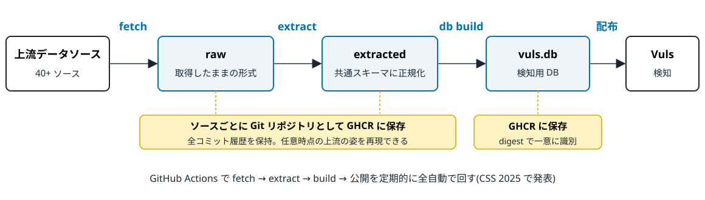
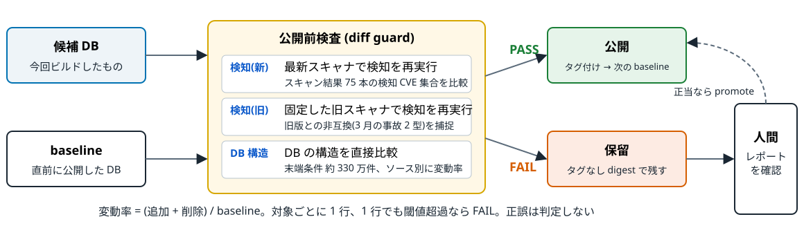
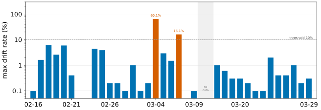
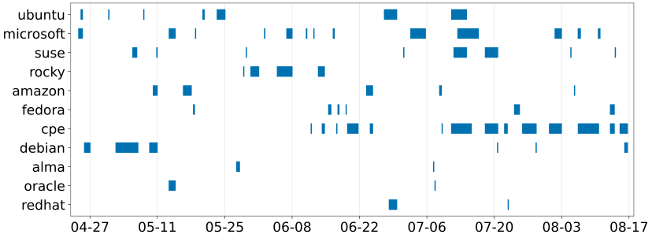
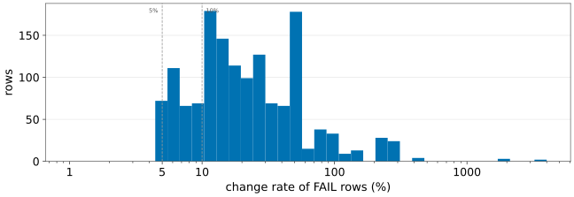

<!-- _class: lead -->
<!-- _paginate: false -->

# 脆弱性情報の上流は安定していない
## 公開前検査による116日間の全数観測

篠原 俊一・中岡 典弘・神戸 康多(フューチャー株式会社)

コンピュータセキュリティシンポジウム 2026 / OWS 2026 / 2F1-2

<!--
発表 15 分 + 質疑 5 分。いまは素材を多めに入れてある(27 枚)。リハ後に「削減候補」コメントの枚から削る。
-->

---

# この発表の位置づけ

- 直前の発表(2F1-1)が **どのデータソースを取るか** の話
- この発表は、その先の **作った DB を公開していいか** の話
- 今日は論文の章立てではなく、**時系列の実話**として話します
  1. 事故を起こした
  2. 検査を作って、見積もりを立てた
  3. 見積もりは外れ、代わりに上流の実態が見えた
  4. 検査は何を止め、何を止められなかったか

---

# 対象システム: 脆弱性DB公開パイプライン



- raw / extracted は**ソースごとに Git リポジトリ**として GHCR に置き、DB も GHCR に **digest で一意に識別**できる形で置く
- **任意時点の上流の姿を後から再現できる**。本発表の「原因帰属」はこの履歴を遡って行う

---

# 第1幕: 2026年3月、壊れた DB を2回公開した

| | 2026-03-06 | 2026-03(同時期) |
|---|---|---|
| 上流 | Red Hat VEX | Ubuntu CVE Tracker |
| 何が | 不正データ × 形式変更で**空データ**を生成 | DB の新しいマーカを**旧スキャナが解釈できず** |
| 結果 | redhat:9 の検知が **51.9% 消えた** | ubuntu 22.04 の検知が **+106.0%(倍増)** |
| CI | **ビルド成功、公開も成功** | 同左 |

* 片方は見逃し(FN)、片方は誤検知(FP)。どちらも CI は緑だった
* CI が確かめていたのは「ビルドが通ったか」であって「生成物が正しいか」ではない

---

# 何が起きたか: 利用者側と運用側

- Vuls を使う商用サービスで、検知結果が一夜で変わった
  - 問い合わせが来る → 運用チームが**過去バックアップから DB をリストア** → 利用者に謝罪
- 迷惑をかけたのは利用者だけではなく、**運用チームにも**
- 「ビルドが通れば公開される」仕組みそのものが問題だった
  - 自動更新は「上流は概ね安定、変化は新規脆弱性の追加が中心」を**暗黙に仮定**していた

> この仮定はどの程度正しいのか? — 答えは 116 日間の本番データで出す

---

# 作ったもの: 公開前検査 (diff guard)



- 候補 DB を**直前の公開版と比較**し、変動率が閾値を超えたら**公開を保留**。正誤は判定しない
- FAIL した候補はタグなし digest で残る。正当なら人間が専用 workflow で **promote**(実行者・digest が履歴に残る)

<!--
3 チェックの呼び方: 検知(新)= 最新スキャナ、検知(旧)= 固定した旧スキャナ、DB 構造 = DB を直接比較。論文の Dn / Do / DB。
-->

---

# 実物: FAIL したとき人間が見るレポート

<div class="small">

GitHub Actions のジョブサマリ、2026-06-16(後述の Microsoft CVRF 消失の run)。まず 3 チェックの集約:

| チェック | 結果 |
|---|---|
| 検知(新) | **FAIL** |
| 検知(旧) | PASS |
| DB 構造 | PASS |

検知(新)の内訳(13 ターゲットが FAIL、抜粋):

| scan result | baseline | target | added | removed | change rate | threshold | result |
|---|--:|--:|--:|--:|--:|--:|---|
| windows_11_21h2 | 879 | 472 | 0 | 407 | **46.3%** | 10.0% | **FAIL** |
| windows_11_25h2 | 1235 | 722 | 0 | 513 | **41.5%** | 20.0% | **FAIL** |
| windows_server_2025 | 1802 | 1285 | 0 | 517 | **28.7%** | 20.0% | **FAIL** |
| windows_10_22h2 | 2697 | 2198 | 0 | 499 | **18.5%** | 10.0% | **FAIL** |

</div>

- **added 0 / removed 407**: 追加が無く削除だけが起きている。6 月分の CVE だけが検知から消えた形

<!--
集約表は 2026-08-24 以降の形式。この run 当時は 1 行のテキスト(diff guard failed: detection(master)=1 ...)。
TODO: 本物のスクショに差し替え候補(run 27646259547 の Summary タブ)。
-->

---

# 見積もり: 「2週間に1回くらい見ればいい」



- 導入前に 37 日分の DB で連続 1 日ペア 35 組を実測。日常変動は中央値 **0.3%**、10% 超は **2 組**だけ
- どちらも実在の上流イベント(Red Hat VEX 65.1% / SUSE OVAL 16.1%)。正常帯と異常が桁で分離
- **週に 1 回も鳴らないだろう**、と思って 2026-04-23 に本番投入した

---

# 第2幕: 翌日から止まった

- 投入翌日(2026-04-24)に初発動。初の手動 promote(04-27)まで **20 run 連続 FAIL**
  - microsoft KB 134.3% / ubuntu:26.04 19.8% / debian_13 6.0% の 3 件が同時
- 続く 3 週間で手動 promote **10 回**。ほぼ毎朝、出社してまずレポートを読んで promote
- FAIL 中は baseline が止まり、**同じ差分が 6 時間ごとに再検出**される
- 当初の実装は最初の FAIL で停止 → debian_13 の FAIL が ubuntu:26.04 の FAIL を**隠していた**
  - 2026-05-08 に「全チェックを走らせてから集約」に変更

---

# 止まるのは上流のせいか、人間のせいか

- 116 日間で 943 run 中 **420 run(44.5%)が FAIL**。手動 promote は **0.79 件/日**
- FAIL した run の **52% が土日**
  - promote は平日日中にしかされない → 金曜夕方のイベントが週末じゅう再 FAIL
  - これは上流の信号ではなく、**人間の応答時間の信号**
- 保留中は直前版を配り続ける = **新規 CVE の反映が遅れる**という別のリスク

<!--
削減候補: 「52% が土日」の 1 文だけ口頭で。
-->

---

# 発想の転換: うるさい検査ではなく、上流の地震計

- 「正当な変更で止まりすぎ」を調べるうちに、FAIL レポートは**上流で何が起きたかの記録**だと気付いた
- 2026-04-23 〜 08-16 の **116 日・943 run を全数収集**(安定版/開発版の 2 系統)
- FAIL した run を「同じ上流ソースの同じ出来事」ごとにまとめると **69 件**(以後の原因分布の単位)
- 全 69 件に「何が原因で動いたか」を付ける

---

# 原因帰属: 履歴で工程を消していく

1. **DB 構築工程**: DB メタデータのビルダーバージョンを比較
2. **収集・変換工程**: 当該ソースのコード履歴を走査
3. **収集対象設定**: seed リスト・対象ソースの変更を走査
4. **上流**: raw の Git 履歴から、件数・ID が一致する変更実体(smoking gun)を探す

* 全 69 件を帰属できた。**「原因不明」は残らなかった**
* 成立条件は全工程の履歴管理 — 昨年の基盤がここで効いた

<!--
削減候補: 次の「実物」と統合。
-->

---

# 実物: 1件の triage はこう終わる(2026-07-26 の例)

```
判定: upstream-driven(上流の正当な変更)

1. builder : created_by 同一(vuls v0.0.1-alpha.0.20260714011358-2af27b6858b4)→ 除外
2. extractor: 窓内に pkg/{extract,fetch}/cisco のコミットなし(main / nightly 両方)→ 除外
3. 収集設定: fetch-cisco の workflow / seed に変更なし → 除外
4. raw     : vuls-data-raw-cisco-json 294641e8 → 5591d648(2026-07-23 → 07-25、4 commits / 114 files)
   smoking gun: 2014/cisco-sa-20140326-sip.json  productNames 149 → 36
                lastUpdated 2014-03-31T13:46:00 / version 1.1 / status Final は不変

推奨: 候補 sha256:39516634… は上流を忠実に反映しており promote 可(判断・実行は人間)
      override(cpe/cisco-json)は churn の継続を見極めてから
```

- この手順は runbook 化してあり、調査の大半は AI エージェントに任せている
- **promote の判断と実行だけは人間**。エージェントには workflow の起動権限を与えない

---

# 結果: 69件のうち59件は上流由来

| 判定 | 件数 | 代表例 |
|---|---|---|
| 上流: 正当な変更 | **55** | 月次パッチ、新ディストリ立ち上がり |
| 上流: 一時的障害 | 2 | 月次データの消失 |
| 上流: 恒久的品質イベント | 2 | errata の再編 |
| 自前: 変換コードのバグ / 意図的変更 | 1 / 7 | 非決定的出力 / CPE 系列 |
| 自前: 収集対象設定 | 2 | 収集起点 ID の追加 |

* 上流由来 59 件 = **平均 2 日に 1 件**、上流が閾値を超えて動いている
* しかもそのほとんどが**正当な変更**。「異常だから止まる」のではない

---

# 116日間のタイムライン



<div class="caption">69 件を上流ソース別に並べたもの。横棒は最初の FAIL から解消まで</div>

<!--
削減候補: 前スライドに吸収。
-->

---

# 第3幕: 上流は消える — Microsoft CVRF

<div class="cols cols-wide-right">
<div>

- 2026 年 6 月分の月次更新データ(723 ファイル)が raw から**丸ごと消え、戻り、また消えた**
- API は HTTP 200。fetch も extract も**成功**
- 候補 DB は Windows の 6 月分 CVE 約 1,270 件だけを欠く
- 検知(新)が windows 13 ターゲットの**削除のみ**変動を検出し保留(7 枚目の表)

</div>
<div class="small">

raw リポジトリ(vuls-data-raw-microsoft-cvrf)の `git log`

| commit | 日時 (UTC) | 変更 | 2026-Jun/ |
|---|---|---|--:|
| 4b5baa90ccf | 06-15 16:57 | | 723 |
| 44181ca9cd1 | 06-16 03:02 | 1460 files, −251,429 行 | **0** |
| 34a4bd55a5f | 06-16 16:33 | +248,779 行 | 811 |
| 5a0dbb67385 | 07-01 14:17 | | 1273 |
| 55abc741d7d | 07-02 02:01 | 1273 files, −327,295 行 | **0** |
| 6dba0210f16 | 07-02 13:26 | +335,383 行 | 1273 |
| 07846b78042 | 07-03 01:42 | −327,838 行 | **0** |
| 0b4ba6131cc | 07-03 13:33 | +338,693 行 | 1278 |

</div>
</div>

---

# 上流は骨抜きになる — AlmaLinux errata

<div class="cols">
<div>

- 2026-05-27、過去 advisory の対象パッケージが一斉に縮退
  - ALSA-2026:2721(kernel): **202 パッケージ(75 種) → 2**
  - 残ったのは kernel-doc と kernel-abi-stablelists だけ
  - 生存 136 advisory の 58% が半減以下、CVE の 87% が検知から消失
- `updated_date` は 2 月のまま。**更新として扱われていない**
- 上流に問い合わせると「**仕様どおり**」
- 対応: 取り込みをピン留めして止め、代替(OVAL)を用意した上で 2026-07-07 に計画的に解除。DB は現在も errata を使用

</div>
<div>

```diff
$ git log -- 10/ALSA/2026/ALSA-2026:2721.json
47a66696b 2026-05-20  packages: 202
e64c5ca88 2026-05-27  packages: 2     (−2406 / +6 行)

$ git show e64c5ca88 -- 10/ALSA/2026/ALSA-2026:2721.json
-    { "name": "kernel",
-      "filename": "kernel-6.12.0-124.38.1.el10_1.aarch64.rpm", ... },
-    { "name": "kernel-core", ... },
-    { "name": "kernel-rt-64k-debug", ... },
     ... 73 パッケージ名分を削除 ...
+    { "name": "kernel-doc",
+      "filename": "kernel-doc-6.12.0-124.38.1.el10_1.noarch.rpm", ... },
+    { "name": "kernel-abi-stablelists", ... }
     "updated_date": 1771853624    ← 2026-02-23(変わらず)
```

</div>
</div>

---

# 上流は黙って書き換わる — Cisco openVuln API

<div class="cols">
<div>

- 2026-07 中旬から、advisory と影響バージョンの対応が**毎日 12:45Z 頃に書き換わる**
  - 4 日で 93 advisory、productNames **2,022 件削除 / 1,481 件追加**
- advisory の **lastUpdated もバージョンも status も不変**。告知もなし
- 2014 年の IOS advisory から 2020 年代の AP 用 train が消える。品質改善には見えるが、AP/WLC を CPE でスキャンしている利用者には**検知消失**

</div>
<div>

```diff
$ git show f5b5023d -- 2014/cisco-sa-20140326-sip.json
  (2026-07-24、−114 / +1 行、productNames 149 → 36)
-    "Cisco IOS 15.3(3)JN14",
-    "Cisco IOS 15.3(3)JN15",
-    "Cisco IOS 15.3(3)JD12",
-    "Cisco IOS 15.3(3)JD13",
-    "Cisco IOS 15.3(3)JDA12",
-    "Cisco IOS 15.3(3)JF2",
     ... 113 行削除 ...

  変わらないフィールド:
  "firstPublished": "2014-03-26T16:00:00",
  "lastUpdated":    "2014-03-31T13:46:00",
  "version": "1.1",  "status": "Final"
```

</div>
</div>

---

# 上流は揺れる — VulnCheck の CPE(2026-07-08)

<div class="cols cols-wide-left">
<div>

- **1 コミットで 145,672 ファイル**(+957 万行)。全年代の CVE に生成 CPE 設定 `vcConfigurations` を一斉付与
  - 例: CVE-1999-0001 にまで `matchCriteriaId: ""` の設定が付く
- **DB 構造チェック**が cpe ecosystem で FAIL
  - 当時は ecosystem 単位の比較。cpe には NVD / JVN / Cisco / VulnCheck など 7 ソースが同居
- 「拡充だろう」と判断して **promote した**

</div>
<div class="small">

翌日(2026-07-09)の DB 構造チェックのレポート

| ecosystem | detection change rate | KB change rate | threshold | result |
|---|--:|--:|--:|---|
| cpe | **28.9%** | 0.0% | 10.0% | **FAIL** |

内訳: root ID の added 587 / removed 64 / **changed 135,457**

</div>
</div>

---

# 後日、ソース単位で測り直すと

<div class="cols">
<div class="small">

同じ 2 つの DB を **DB 構造チェック**でソース単位に再計測

| ecosystem | source | change rate | result |
|---|---|--:|---|
| cpe | nvd-api-cve | ≤ 5.4% | PASS |
| cpe | jvn-feed-detail | ≤ 5.4% | PASS |
| cpe | cisco-json | ≤ 5.4% | PASS |
| cpe | vulncheck-nist-nvd2 | **189.6%** | **FAIL** |

**検知チェック**に CPE のスキャン結果を足して再実行(baseline → target の検知 CVE 数)

| scan result | baseline | target | 変化 |
|---|--:|--:|--:|
| cpe_jvn | 69 | 17 | **−75.4%** |
| cpe_cisco | 67 | 24 | **−64.2%** |
| cpe_nvd | 24 | 19 | −20.8% |

</div>
<div>

- ecosystem 一括の 28.9% の実体は **VulnCheck 単独の 189.6%**。NVD がノイズフロアになって希釈していた
- CPE 経由の検知が **60〜75% 消失**していた。語彙が変わってインデックスから外れたため
- 「拡充」と「検知退行」が同時に来る。promote した DB には検知退行が含まれていた
- → 閾値を**ソース単位**にし、CPE のスキャン結果を検知チェックに追加(2026-07-14)

</div>
</div>

---

# 正当でも桁違いに動く



- 観測史上最大は fedora:46 の **3433.3%**: 末端条件 **6 → 212 件**。異常の大きさではなく**分母の小ささ**を測っていた
- Oracle UEK は **1 advisory に CVE 822 件**。Linux kernel CNA の一括発番(2026-07-24〜25、CVE-2026-64xxx)は Debian と VulnCheck に同日流入
- 日常変動の 5〜20% と、100% 超の構造的イベントが裾を作る

<!--
削減候補: 図だけ見せて 3433% の 1 文で流す。
-->

---

# 第4幕: 検査は何を止めたか — 3件

<div class="cols">
<div>

- **Microsoft CVRF 全消失 × 2**: 約 1,270 CVE 分の検知消失に相当する DB を**公開せず破棄**
- **自前の変換コードのバグ × 1**(fedora、2026-06-19)
  - DB 構造チェックが fedora:45 で **274.5%**
  - raw の変化 266 ファイルに対し extracted は **23,163** → 上流ではなく自分
  - 配列のソート漏れ。**コンパイルもテストも通る**バグが、出力の構造差分で初めて見えた

</div>
<div>

```
| fedora:45 | 274.5% | 0.0% | 50.0% | FAIL |
```

```diff
FEDORA-2026-54c7ad647e / package "bind" / architectures
(raw は 2 つの DB でバイト同一)
- ["aarch64","i686","ppc64le","s390x","src","x86_64"]
+ ["src","x86_64","aarch64","i686","ppc64le","s390x"]
```

```diff
// vuls-data-update pkg/extract/fedora/api/api.go
- util.Write(path, &data)   // *Data: case Data: に落ちず Sort() されない
+ util.Write(path, data)
```

</div>
</div>

---

# 止めきれなかった2件 → 最弱環は承認側

- **AlmaLinux 縮退**: FAIL 滞留を片付ける流れで縮退候補を promote → **数時間公開**してしまった
- **VulnCheck**: 28.9% という希釈された数字を見て promote → 検知退行を含む DB が公開された
- 2 件とも**検出と保留までは成功**。失敗したのは人間の判断
  - レポートの分解能 → ソース単位(2026-07-14 導入)
  - **削除方向は追加より厳しく** → 変動率を added / changed / removed の軸に分けた<span class="badge">論文後</span>
  - 複数名承認。promote の判断と実行は人間に限定

```
# vuls2 diff の既定値(2026-10-09 merge)。override は軸を名指ししないと緩まない
diff db        --rate-threshold added:30,changed:10,removed:10
diff detection --rate-threshold added:30,removed:5
               --rate-threshold-override cpe/cisco-json=removed:25
```

---

# エピローグ(1): 観測が終わった4日後、Fortinet

<div class="cols">
<div>

- advisory ページが全クライアントに Cloudflare の確認画面を **HTTP 200** で返すようになった
- fetch は「CSAF なし」と判定 → sweep 後に何も書かず **exit 0** → 「上流が全部取り下げた」として**削除を commit**
- 2026-01 から 1 件ずつ消え、**08-20 に残り 181 件を全削除**。run は緑。次の run で空ツリーの `git restore .` が落ちて初めて気付いた
- 対策: 23 workflow に「**空になった repo を commit しない**」ガード

</div>
<div>

```
$ git log --diff-filter=D   (vuls-data-raw-fortinet-csaf)
f4f1d3d 2026-01-22  deleted   2   left  88
2dd3ea9 2026-02-06  deleted   1   left  89
d1ed230 2026-02-21  deleted   1   left  98
c79f291 2026-02-28  deleted   1   left  97
154c743 2026-03-08  deleted   1   left  96
ac1fda0 2026-04-07  deleted   1   left 119
25f9f6c 2026-04-29  deleted   1   left 146
5a8924a 2026-06-28  deleted   1   left 162
56fc622 2026-08-20  deleted 181   left   0
        181 files changed, 59632 deletions(-)
```

```
$ curl -i https://fortiguard.fortinet.com/psirt/FG-IR-25-250   (2026-10-09)
HTTP/2 500
<title> The URL you requested has been blocked </title>
```

</div>
</div>

---

# エピローグ(2): 収集段階で見える壊れ方(2026-09〜10)

<div class="cols cols-wide-left">
<div>

DB に入っているソース

- **Fedora**: Bugzilla が security bug を `NotPermitted` で拒否(**54,169 → 58,767 件**と増加)。CVE ID が advisory から消え、fedora_42 が 13.5% で FAIL(検査で捕捉)
- **ENISA EUVD**: 201 ページ目で `403 Forbidden`。fetch が止まり更新が止まる

収集だけしているソース(DB 未収載)

- **Wind River**: CVE tracker に**テンプレートが埋まっていない行**(17 ファイル)
- **openEuler**: CSAF の `product_ids` が配列ではなくオブジェクト

</div>
<div>

```
# fedora-api raw(2026-09)
{"bug_id": "2398586", "error": "NotPermitted"}
# REST: code 102 "You are not authorized to access bug #2398586"
```

```
# enisa-euvd fetch(2026-10-07)
GET .../api/search?page=201&size=100
  giving up after 6 attempt(s): unexpected HTTP status 403 Forbidden
```

```
# windriver-cve-tracker  active/CVE-2010-5312
Patches_chromium-x11:
{recipe_rcpl}_{package}: {status}
```

```
# openeuler-csaf fetch(2026-10-07)
json: cannot unmarshal JSON object into Go []csaf.ProductID
```

</div>
</div>

<!--
Fedora の前史: 2025-11-25 に Fedora が AI クローラ対策(Anubis)を入れ、fetch が challenge ページを掴んで全滅。Accept ヘッダで回避(vuls-data-update #634)。
削減候補: Wind River / openEuler は DB 未収載なので、時間が無ければ落とす。
-->

---

# まとめ

* 上流は消え、戻り、遡及的に書き換わり、告知なく再編される。**しかも大半は正当な変更**
* 「ビルドが通ったか」ではなく「**生成物が前回と比べてどう動いたか**」を見ないと事故は防げない
* 全工程の履歴管理があれば、発動の**全件を根拠付きで原因帰属**できる
* 検査が保証するのは**自動保留まで**。最終判断は人間に残り、承認側の設計が次の課題

---

<!-- _class: lead -->

# 公開しています

論文・データ(run 表、69 episode 判定表、集計スクリプト)
**github.com/vulsio/css2026-diff-guard**

検査の実装: vuls2 / 閾値設定: vulsio/vuls-data-db

ご質問・追試歓迎です
